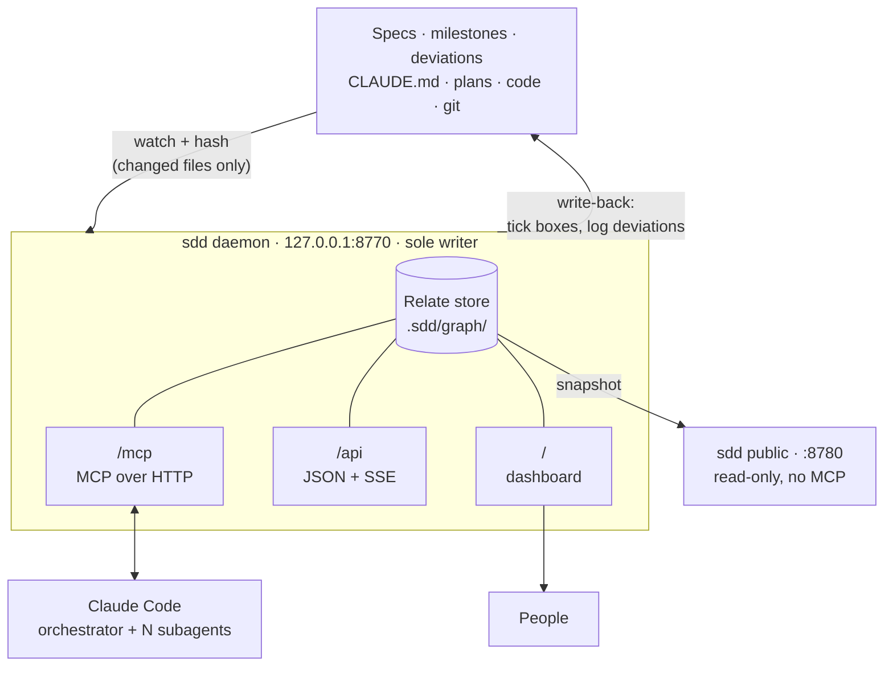
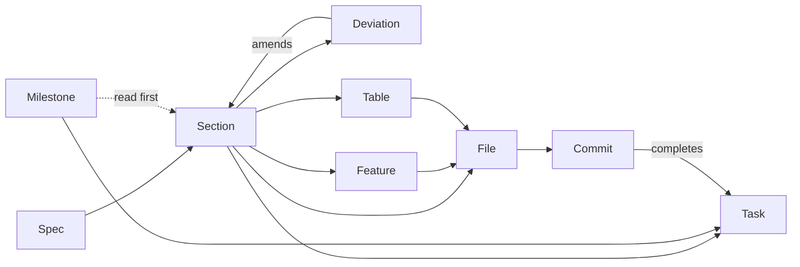

# SDD Graph

> Working name. Package `relate-sdd`, CLI `sdd`. Built for the [Relate by Neo4j Hackathon](https://relate.devpost.com/).

SDD Graph turns a spec-driven repo into one live **[Relate](HANDOFF.md)** graph. Agents query that graph over MCP, and people browse it in a dashboard. The repo's specs, milestones, deviations, CLAUDE.md files, plans, code and git history all go into it. Agents claim tasks atomically and pull a small context packet, so they don't re-read whole Markdown files every session.

**Markdown stays the source of truth.** The graph can be rebuilt from Markdown, code and git at any time. The only exceptions are claims, agents and events.

> **Status (2026-11-21):** building. Specs v1 and milestones are written; the Docker dev environment and package skeleton are done ([M00a](docs/milestones/done/M00a-docker-and-skeleton.md)). Everything below describes the planned v1. The milestone that builds each part is listed next to it. Next up: [M00b: Relate access layer](docs/milestones/M00b-relate-access-layer.md).

## Why

Spec-driven development works well with AI agents, but it has three costs:

1. **Token bloat.** Every session re-reads whole files to find the few sections a task needs, or to find out what changed.
2. **Parallel write collisions.** Subagents ticking boxes in the same milestone file or CLAUDE.md overwrite each other.
3. **Lost lineage.** It's hard to see which deviation changed a spec section that a later task depends on, or which spec, task and deviation explain why a file exists.

SDD Graph keeps the Markdown workflow and adds a graph next to it. The graph gives exact context, atomic coordination and traceable lineage.

## How it works



- **One process owns the store.** Relate is a single-process engine, so the daemon is the only writer. MCP runs over localhost HTTP, never stdio, so every Claude Code session shares that one daemon.
- **Write-back works like the manual process.** Completing a task ticks its box. Logging a deviation writes the deviation file, the index row and the spec note, the same edits a human makes today.
- **Public mode is read-only.** The hosted demo opens a snapshot with `read_only=True`. It serves no MCP and no write routes.

### What connects to what



[SPEC-02](docs/specs/SPEC-02-graph-schema.md) owns the full schema.

## Agent tools (MCP)

| Tool | Purpose |
|---|---|
| `status`, `next_tasks` | Milestone progress, active claims, claimable tasks |
| `claim_task`, `release_task` | Atomic claims; `force` frees a failed agent's claim |
| `get_context` | The context packet for a task: its milestone, the sections to read with the deviations that amend them, upstream outcomes, related code |
| `read_section` | Section text by reference, e.g. `"SPEC-03 §4.2"` (replaces grep + Read) |
| `log_deviation` | Writes the deviation file, the index row and the spec note |
| `complete_task`, `complete_milestone` | Tick the box, record notes, files and commit; return newly unblocked tasks |
| `what_changed` | Changes since a time, an event or `"last_session"` |
| `impact`, `explain`, `find_code` | Code context: what a change touches, why a file exists |
| `query` | Read-only Cypher through a query guard, always rolled back |

[SPEC-05](docs/specs/SPEC-05-agent-tools.md) has the full index and the agent protocol.

**Agent protocol, in short:**
- **Orchestrator:** `status` → `next_tasks` → one subagent per non-overlapping task → review → `complete_milestone`
- **Worker:** `claim_task` → `get_context` → build and test → `log_deviation` for each departure → `complete_task`
- **Every session start:** `what_changed(since="last_session", agent=…)` instead of re-reading docs

## Quick start (planned)

Everything runs in Docker. Nothing needs to be installed on the host apart from Docker.

**Judges / try the sample** (from M06b):

```bash
docker compose up
# dashboard: http://localhost:8770
```

**Development** (from M00a):

```bash
docker compose -f docker-compose.dev.yml up -d dev
docker compose -f docker-compose.dev.yml exec dev uv sync
docker compose -f docker-compose.dev.yml exec dev uv run pytest -q
docker compose -f docker-compose.dev.yml exec dev uv run sdd daemon --host 0.0.0.0   # from M02
```

**Use it on your own SDD repo** (from M03b):

```bash
sdd init      # writes .sdd/config.toml, merges an "sdd" server into .mcp.json, adds the agent skill
sdd daemon    # sync + serve MCP, API and dashboard on 127.0.0.1:8770
sdd status    # milestones, claims, warnings
sdd doctor    # parser warnings, unresolved links, duplicate IDs
```

[SPEC-08](docs/specs/SPEC-08-cli-and-exports.md) lists every CLI command.

## Repo format it expects

SDD Graph reads an existing spec-driven layout. The only new convention it needs is stable task IDs, and `sdd ids --write` can add them to existing checkbox lines.

```
docs/specs/SPEC-NN-*.md          specs; each heading is an addressable section
docs/milestones/M<nn>[a-z]-*.md  milestones; one checkbox per task
                                 - [ ] **M02.3** text (after M02.1)
docs/deviations/D<nnn>-*.md      deviations, indexed in docs/DEVIATIONS.md
CLAUDE.md, plan files, code, .git
```

[SPEC-03](docs/specs/SPEC-03-markdown-parsing.md) has the parsing rules.

## Documentation

This repo is built with the workflow it improves.

| | |
|---|---|
| [docs/IDEA.md](docs/IDEA.md) | The locked idea: problem, users, scope, non-goals |
| [HANDOFF.md](HANDOFF.md) | Background and verified Relate facts |
| [docs/specs/](docs/specs/) | Source of truth. Start with [SPEC-00](docs/specs/SPEC-00-overview.md) (concepts and global conventions) |
| [docs/milestones/](docs/milestones/) | Worked in number order, one at a time |
| [docs/DEVIATIONS.md](docs/DEVIATIONS.md) | Mandatory log of every departure from the specs |
| [docs/decisions/](docs/decisions/README.md) | Accepted design decisions (DEC-001 to DEC-004) |
| [CLAUDE.md](CLAUDE.md) | Working rules for AI agents in this repo |

## Roadmap

| Milestone | Delivers |
|---|---|
| M00a, M00b | Docker dev environment, package skeleton, Relate access layer |
| M01a, M01b | Markdown parsers, graph upsert and full sync |
| M02 | Sync daemon with write-back |
| M03a, M03b | Coordination tools, context packets, query guard; this repo switches to using itself |
| M04a, M04b | Code and git layer, schema tables, features, `impact` / `explain` |
| M05a, M05b | Dashboard: graph, milestone board, Impact and Explain views |
| M06a, M06b | Invented sample project, exports, public mode, sprint replay, hosted demo |
| M07 | Token benchmark: Markdown vs graph |
| M08 | Static zero-install demo with Relate's WASM build (stretch) |
| M99 | Security sweep and submission |

## Security

- The daemon binds to `127.0.0.1`. An optional bearer token (`SDD_TOKEN`) is supported.
- Arbitrary Cypher only runs through the query guard, read-only and always rolled back.
- The public demo opens a read-only snapshot and has no write routes.
- Secrets come only from the environment or `deploy/.env`.

[SPEC-09](docs/specs/SPEC-09-security.md) has the details.
