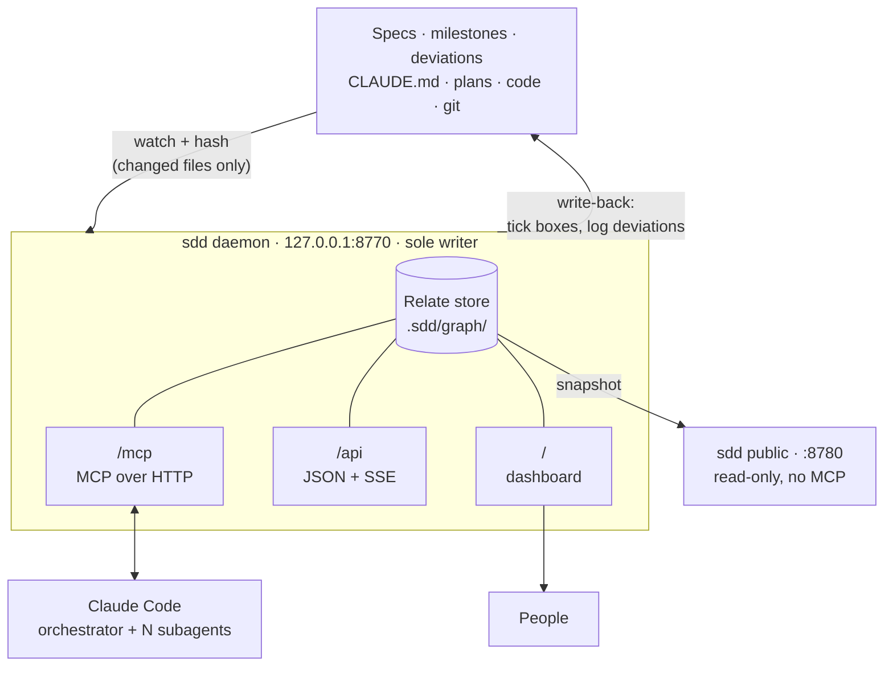
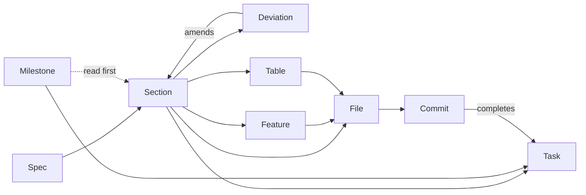

# SDD Graph

> Working name. Package `relate-sdd`, CLI `sdd`. Built for the [Relate by Neo4j Hackathon](https://relate.devpost.com/).

SDD Graph turns a spec-driven repo into one live **[Relate](HANDOFF.md)** graph. Agents query that graph over MCP, and people browse it in a dashboard. The repo's specs, milestones, deviations, CLAUDE.md files, plans, code and git history all go into it. Agents claim tasks atomically and pull a small context packet, so they don't re-read whole Markdown files every session.

**Markdown stays the source of truth.** The graph can be rebuilt from Markdown, code and git at any time. The only exceptions are claims, agents and events.

> **Status (2026-11-22):** v1 built. Every milestone from M00a to M08 is done ([docs/milestones/done/](docs/milestones/done/)), with nine logged deviations (D001–D009, see [DEVIATIONS.md](docs/DEVIATIONS.md)). The repo has been built with its own tool since M03b. One milestone is left: [M99: Release and submission](docs/milestones/M99-release-and-submission.md) (security sweep, final stores, README, video, submission).
>
> **Try it:** live dashboard at <https://sddrelate.myradiantvision.com> · zero-install static demo at <https://fikriashraf95.github.io/mrv-sdd-relate/> · locally with `docker compose up`.

## Why

Spec-driven development works well with AI agents, but it has three costs:

1. **Token bloat.** Every session re-reads whole files to find the few sections a task needs, or to find out what changed.
2. **Parallel write collisions.** Subagents ticking boxes in the same milestone file or CLAUDE.md overwrite each other.
3. **Lost lineage.** It's hard to see which deviation changed a spec section that a later task depends on, or which spec, task and deviation explain why a file exists.

SDD Graph keeps the Markdown workflow and adds a graph next to it. The graph gives exact context, atomic coordination and traceable lineage.

## How it works



- **One process owns the store.** Relate is a single-process engine, so the daemon is the only writer. MCP runs over localhost HTTP, never stdio, so every Claude Code session shares that one daemon.
- **Write-back works like the manual process.** Completing a task ticks its box. Logging a deviation writes the deviation file, the index row and the spec note, the same edits a human makes today.
- **Public mode is read-only.** The hosted demo opens a snapshot with `read_only=True`. It serves no MCP and no write routes.

### What connects to what



[SPEC-02](docs/specs/SPEC-02-graph-schema.md) owns the full schema.

## How Relate is used and why

[Relate](https://relatedb.ai/) is an embedded property-graph engine with Cypher, "closer to SQLite than to a clustered graph server". SDD Graph embeds it in-process through the Python package `relate-db` (≥ 1.2). It is the only database in the project.

**Storage modes**

| Mode | Where | Why |
|---|---|---|
| **Directory** (WAL + Parquet shards) | `.sdd/graph/` in each project, owned by the daemon | The live store. It travels with the repo, survives restarts, and Relate can open it `read_only` beside the writer, so the dashboard, `sdd query` and the public process read snapshots without blocking writes. It holds graph-only state (claims, agents, events) that Markdown can't rebuild. |
| **Single file** (`.rl`) | `.sdd/snapshots/graph.rl`, `samples/courtside/.sdd/snapshots/graph.rl` | One portable, committed file that judges can open with the `relate` CLI. |
| **Directory, JSON codec** | `.sdd/snapshots/graph-json/` | A readable copy of the same graph, diffable in git. |
| **In-memory** (`:memory:`) | Tests, `sdd doctor --store :memory:` | Fast throwaway graphs; nothing is written to disk. |
| **Relate WASM** (`@relate/relate-wasm`) | The static demo | Loads the sample's exported `graph.cypher` in the browser in ~0.3 s, so the Query tab runs real Cypher with no server. |

The committed stores are the sample's built store (`samples/courtside/.sdd/graph/`) and `sdd snapshot` output (directory, `.rl` and JSON copies, made with `relate clone`). This repo's live `.sdd/graph/` is never committed ([DEC-001](docs/decisions/DEC-001-committed-store.md)).

**Why a graph, and why Relate**

- **The questions are traversals.** "Which sections does this task need, and which deviations amend them?", "what does changing the `bookings` table touch?", "why does this file exist?" are each one Cypher pattern across specs, sections, tasks, deviations, tables, features, files and commits. In Markdown they take many grep-and-read rounds. `impact` and `explain` return the shortest `via` chain for every hit, so an agent sees *why* something is related, not just *that* it is.
- **Embedded, per project, no server.** A spec-driven repo is a single project on a laptop. Relate needs no database server to install or run: `pip install` and a directory next to the code. The same engine runs in Docker, in tests (`:memory:`) and in the browser (WASM).
- **Transactions make coordination atomic.** `claim_task` checks the holder, the dependencies and liveness, then sets the claim in one transaction on one writer, so two agents can never both win a task (the benchmark: 0 double claims, 0 lost ticks against 139 for agents editing Markdown).
- **Read-only snapshots make public mode safe.** The hosted demo opens the store with `read_only=True` and serves no write route. Arbitrary Cypher runs only through the query guard: keyword checks, bounded variable-length patterns, always rolled back, in a killable worker process with a memory cap ([D006](docs/DEVIATIONS.md)).

**Designed around Relate's limits**

- **Single-process engine.** One process owns a store, so the daemon is the only writer and every write goes through one queue on one thread (Relate connections are thread-affine). MCP runs over localhost HTTP, never stdio, so every Claude Code session shares that one daemon instead of starting a process that would fight over the store. Retryable conflicts are retried at 50 / 200 / 800 ms.
- **No map properties.** Maps are stored as JSON strings under `<name>_json` and decoded on the way out.
- **No per-query timeout or row cap** in `relate-db` 1.2: the query guard enforces 100 rows, 5 s and a memory cap itself.
- **One door.** Only [src/sdd/graph/store.py](src/sdd/graph/store.py) imports `relate`, and an import-linter contract enforces it.
- **The Markdown vault store isn't released yet**, so SDD Graph has its own Markdown → graph sync and write-back.

## Agent tools (MCP)

| Tool | Purpose |
|---|---|
| `status`, `next_tasks` | Milestone progress, active claims, claimable tasks |
| `claim_task`, `release_task` | Atomic claims; `force` frees a failed agent's claim |
| `get_context` | The context packet for a task: its milestone, the sections to read with the deviations that amend them, upstream outcomes, related code |
| `read_section` | Section text by reference, e.g. `"SPEC-03 §4.2"` (replaces grep + Read) |
| `log_deviation` | Writes the deviation file, the index row and the spec note |
| `complete_task`, `complete_milestone` | Tick the box, record notes, files and commit; return newly unblocked tasks |
| `what_changed` | Changes since a time, an event or `"last_session"` |
| `impact`, `explain`, `find_code` | Code context: what a change touches, why a file exists |
| `query` | Read-only Cypher through a query guard, always rolled back |

[SPEC-05](docs/specs/SPEC-05-agent-tools.md) has the full index and the agent protocol.

**Agent protocol, in short:**
- **Orchestrator:** `status` → `next_tasks` → one subagent per non-overlapping task → review → `complete_milestone`
- **Worker:** `claim_task` → `get_context` → build and test → `log_deviation` for each departure → `complete_task`
- **Every session start:** `what_changed(since="last_session", agent=…)` instead of re-reading docs

## Quick start

Everything runs in Docker. Nothing needs to be installed on the host apart from Docker.

**Judges / try the sample** (`samples/courtside/`, an invented project whose centrepiece table is `bookings`):

```bash
docker compose up
# dashboard: http://localhost:8770
```

**Live demo:** <https://sddrelate.myradiantvision.com>. The same sample in public mode: a read-only snapshot, no MCP, no write routes, guarded queries in a killable worker process.

**Zero-install demo:** <https://fikriashraf95.github.io/mrv-sdd-relate/>. The Query tab runs Relate in WebAssembly in your browser; the other views use answers precomputed from the same graph. If your browser can't load WASM, the Query examples still run (the footer says which mode you're in).

**Development:**

```bash
docker compose -f docker-compose.dev.yml up -d dev
docker compose -f docker-compose.dev.yml exec dev uv sync
docker compose -f docker-compose.dev.yml exec dev uv run pytest -q
docker compose -f docker-compose.dev.yml exec dev uv run sdd daemon --host 0.0.0.0
```

**Use it on your own SDD repo:**

```bash
sdd init      # writes .sdd/config.toml, merges an "sdd" server into .mcp.json, adds the agent skill
sdd daemon    # sync + serve MCP, API and dashboard on 127.0.0.1:8770
sdd status    # milestones, claims, warnings
sdd doctor    # parser warnings, unresolved links, duplicate IDs
```

[SPEC-08](docs/specs/SPEC-08-cli-and-exports.md) lists every CLI command.

## Benchmark

`sdd bench` compares the graph with the Markdown workflow ([full results](bench/results/2026-11-22.md)):

| Measure | Markdown | Graph |
|---|---|---|
| Context per task, sample (30 tasks) | 2,009 tokens (grep + Read sections) | 780 tokens, **−61.2%** |
| Context per task, this repo (20 tasks, [results](bench/results/self/2026-11-22.md)) | 13,239 tokens | 3,714 tokens, **−71.9%** |
| Session restart after edits | 2,731 tokens (re-read 7 files) | 324 tokens (one `what_changed`), **−88.1%** |
| 10 agents, 30 tasks, 5 runs | 139 lost ticks | **0 lost ticks, 0 double claims** |

The sample's 61.2% falls short of the 70% target ([D007](docs/DEVIATIONS.md)). Tasks whose lines link the spec sections they implement get the biggest savings; unlinked tasks save little.

## Repo format it expects

SDD Graph reads an existing spec-driven layout. The only new convention it needs is stable task IDs, and `sdd ids --write` can add them to existing checkbox lines.

```
docs/specs/SPEC-NN-*.md          specs; each heading is an addressable section
docs/milestones/M<nn>[a-z]-*.md  milestones; one checkbox per task
                                 - [ ] **M02.3** text (after M02.1)
docs/deviations/D<nnn>-*.md      deviations, indexed in docs/DEVIATIONS.md
CLAUDE.md, plan files, code, .git
```

[SPEC-03](docs/specs/SPEC-03-markdown-parsing.md) has the parsing rules.

## Documentation

This repo is built with the workflow it improves.

| | |
|---|---|
| [docs/IDEA.md](docs/IDEA.md) | The locked idea: problem, users, scope, non-goals |
| [docs/specs/](docs/specs/) | Source of truth. Start with [SPEC-00](docs/specs/SPEC-00-overview.md) (concepts and global conventions) |
| [docs/milestones/](docs/milestones/) | Worked in number order, one at a time |
| [docs/DEVIATIONS.md](docs/DEVIATIONS.md) | Mandatory log of every departure from the specs |
| [docs/decisions/](docs/decisions/README.md) | Accepted design decisions (DEC-001 to DEC-004) |
| [CLAUDE.md](CLAUDE.md) | Working rules for AI agents in this repo |

## Roadmap

| Milestone | Delivers | Status |
|---|---|---|
| M00a, M00b | Docker dev environment, package skeleton, Relate access layer | Done |
| M01a, M01b | Markdown parsers, graph upsert and full sync | Done |
| M02 | Sync daemon with write-back | Done |
| M03a, M03b | Coordination tools, context packets, query guard; this repo switches to using itself | Done |
| M04a, M04b | Code and git layer, schema tables, features, `impact` / `explain` | Done |
| M05a, M05b | Dashboard: graph, milestone board, Impact and Explain views | Done |
| M06a, M06b | Invented sample project, exports, public mode, sprint replay, hosted demo | Done |
| M07 | Token benchmark: Markdown vs graph | Done |
| M08 | Static zero-install demo with Relate's WASM build | Done |
| M99 | Security sweep, final stores, README, video and submission | **Next** |

## Security

- The daemon binds to `127.0.0.1`. An optional bearer token (`SDD_TOKEN`) is supported.
- Arbitrary Cypher only runs through the query guard, read-only and always rolled back.
- The public demo opens a read-only snapshot and has no write routes.
- Secrets come only from the environment or `deploy/.env`.

[SPEC-09](docs/specs/SPEC-09-security.md) has the details.
