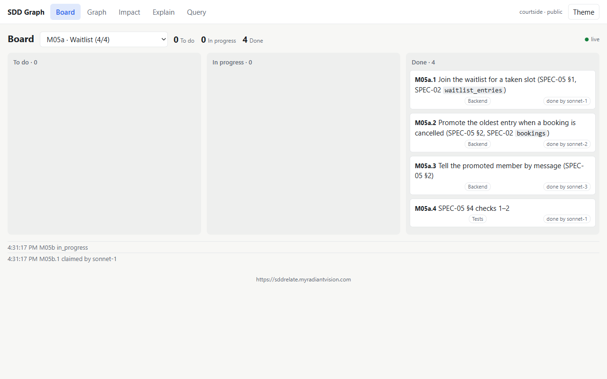
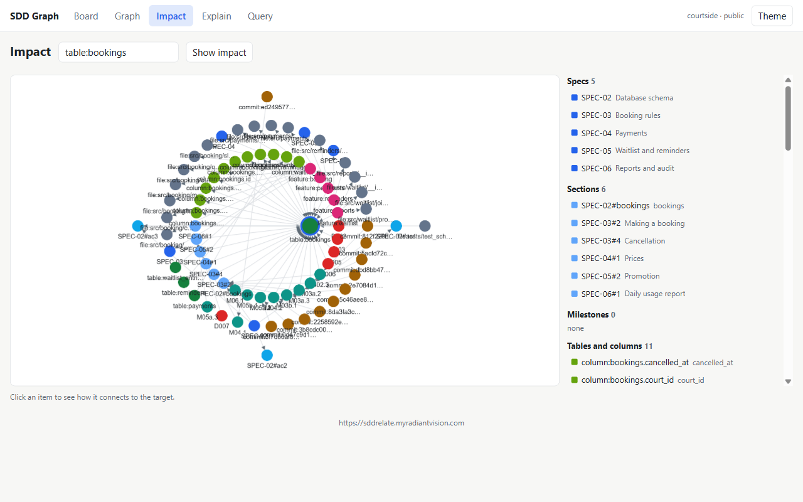

# 1. Introduction

> **For:** anyone deciding whether SDD Graph is worth their time. **Time:** 3 minutes.

## The problem

Spec-driven development (SDD) works well with AI coding agents. You write specs, split the work into milestones of checkbox tasks, and log every place the code departs from a spec. Then an agent builds one task at a time. That workflow has three costs, and they grow with the repo:

1. **Token bloat.** Every session re-reads whole files to find the few sections a task needs, or to find out what changed since yesterday. Most of what an agent reads is not about its task.
2. **Write collisions.** When several subagents work one milestone in parallel, they tick boxes in the same milestone file and edit the same CLAUDE.md, so their edits overwrite each other. Nothing stops two agents from starting the same task.
3. **Lost lineage.** It's hard to answer "which deviation changed the spec section this task depends on?" or "why does this file exist, and what shaped it?". The answer is spread across specs, milestones, deviation files, commits and code.

## What SDD Graph does

SDD Graph is a small Python daemon that runs next to your repo. It reads your specs, milestones, deviations, CLAUDE.md files, plan files, code tree and git history, and keeps them in one embedded [Relate](https://relatedb.ai/) graph that it updates as files change. Then it serves that graph:

- **to AI agents over MCP**: claim a task atomically, get a small *context packet* with exactly the sections it needs, log a deviation, complete a task, ask what changed since the last session, and ask what a change affects;
- **to people through a dashboard**: a live milestone board, a graph browser, *Impact* and *Explain* views, and a read-only Cypher query tab;
- **to scripts through a CLI and a JSON API**.

**Markdown stays the source of truth.** When an agent completes a task, the daemon ticks the box in the milestone file. When it logs a deviation, the daemon writes the deviation file, the index row and the spec note, the same edits you would make by hand. You can delete the graph at any time and rebuild it from the files. The only things you'd lose are the claims, agent records and event history, which exist only in the graph.


*The Board on the live demo: simulated agents working a milestone. Cards move as agents claim and complete tasks.*


*Impact for the `bookings` table: every spec, section, file, task, deviation, test and commit it reaches, each with the chain of links that connects it.*

## Measured results

`sdd bench` compares the graph with the Markdown workflow, and you can reproduce the numbers ([full results](../../bench/results/2026-11-22.md)):

| Measure | Markdown workflow | SDD Graph |
|---|---|---|
| Context per task, Courtside sample (30 tasks) | 2,009 tokens (grep + read sections) | 780 tokens, **61.2% less** |
| Context per task, this repo (20 tasks) | 13,239 tokens | 3,714 tokens, **71.9% less** |
| Session restart after edits | 2,731 tokens (re-read 7 files) | 324 tokens (one `what_changed` call), **88.1% less** |
| 10 agents, 30 tasks, 5 runs | 139 lost checkbox ticks | **0 lost ticks, 0 double claims** |

The savings grow with the size of your specs. They are largest when task lines link the spec sections they implement (see [Write task lines that get small packets](how-to/link-tasks-to-sections.md)).

## Who it's for

- **Developers who run AI agents on spec-driven repos**, especially several subagents in parallel (Claude Code or any MCP client).
- **Tech leads** who want to see at a glance who is working on what, and what a spec change will affect before they make it.
- **Anyone onboarding to an SDD repo** who wants to ask "why does this file exist?" and get an answer with sources.

It expects a repo laid out roughly like this. The only new convention is a stable ID on each task line, and `sdd ids --write` adds those for you:

```
docs/specs/SPEC-NN-*.md          specs: each heading is an addressable section
docs/milestones/M<nn>[a-z]-*.md  milestones: one checkbox per task
                                 - [ ] **M02.3** text (after M02.1)
docs/deviations/D<nnn>-*.md      deviations, indexed in docs/DEVIATIONS.md
CLAUDE.md, plan files, code, .git
```

## What it isn't

- **Not a task tracker that replaces Markdown.** There is no ticket database. Tasks live in your milestone files; the graph only mirrors them and adds claims.
- **Not a hosted service.** It runs on your machine, one daemon per repo, bound to `127.0.0.1`. The public demo is a read-only copy of a sample, not a multi-user product.
- **Not a spec editor.** No tool edits spec prose. Agents can append a deviation note to a section, and that's all. People write the specs.
- **Not multi-machine.** One process owns one store. Agents on other machines need a tunnel and a token (see [Remote access](how-to/token-and-remote-access.md)).
- **Not magic for unstructured docs.** It parses a specific (but common) SDD layout. Loose notes become Doc nodes with links, nothing more.

## Next

- Try it in five minutes with no setup: [Quick start](02-quick-start.md).
- Or look before installing anything: the [live demo](https://sddrelate.myradiantvision.com) and the [zero-install static demo](https://fikriashraf95.github.io/mrv-sdd-relate/).
- Understand the ideas: [Concepts](03-concepts.md).
