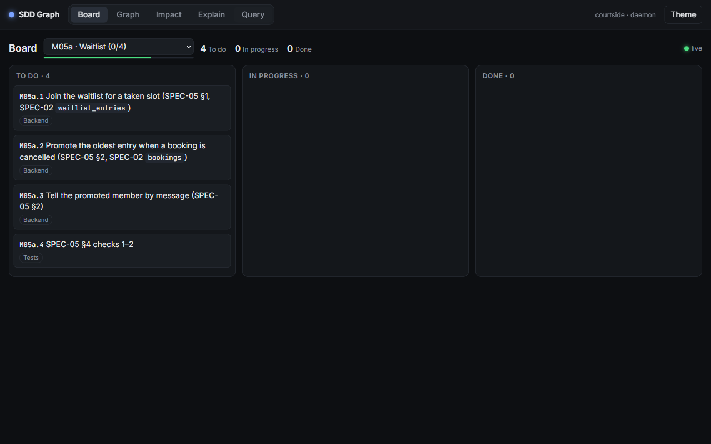
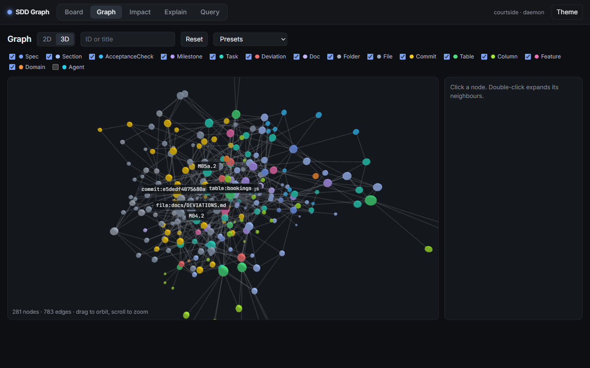
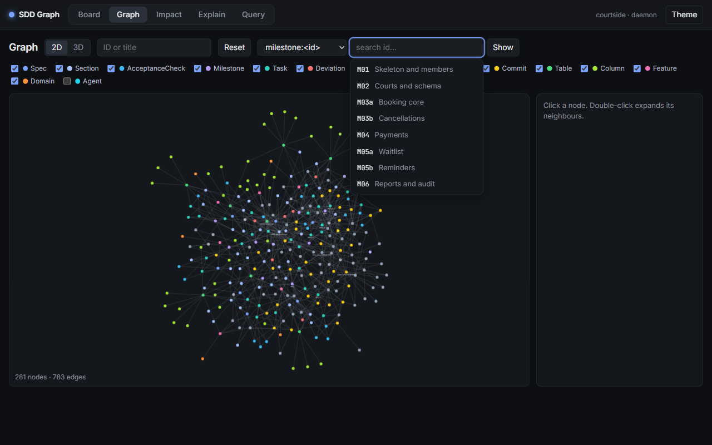
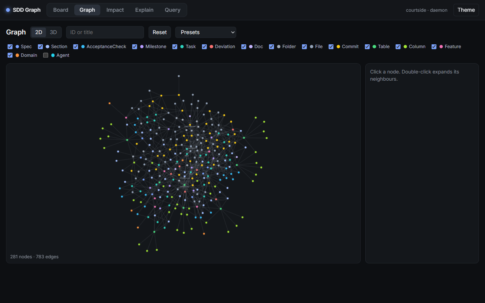
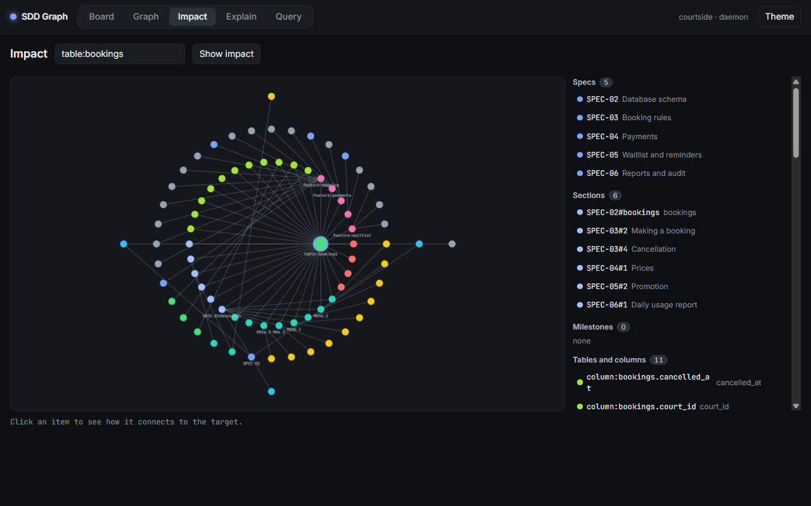
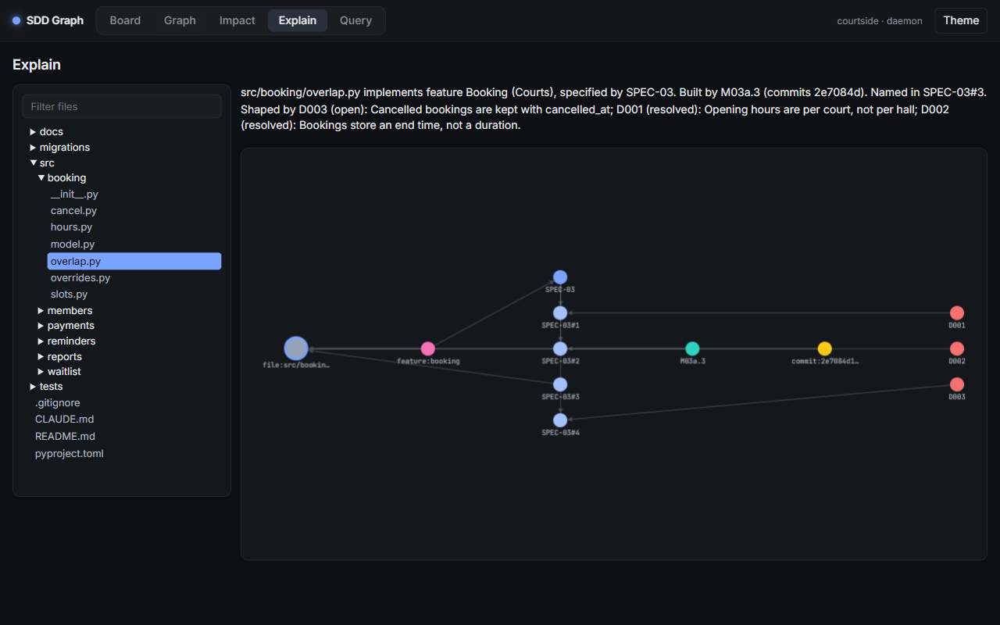
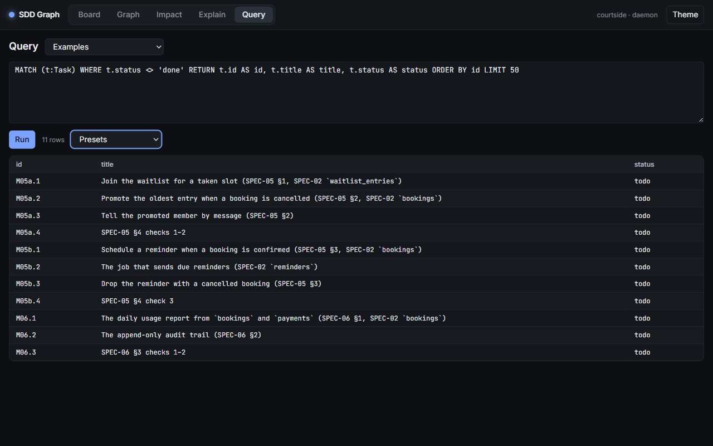

# 2. Quick start: try the sample

> **For:** visitors, judges, and anyone who wants to see it working before reading more. **Time:** 5 minutes. **You need:** Docker (with Compose) and a browser. Nothing else is installed on your machine.

You'll start SDD Graph on **Courtside**, an invented court-booking app for a community sports hall that ships with this repo (`samples/courtside/`). It has 7 specs, 8 milestones, 30 tasks, 6 deviations, a small code tree and a scripted git history of about 40 commits. Its central table is `bookings`, which nearly everything touches, so it's a good target for *Impact*.

> **No Docker?** Open the [live demo](https://sddrelate.myradiantvision.com), where simulated agents work the sample in a loop, or the [static demo](https://fikriashraf95.github.io/mrv-sdd-relate/), which runs in your browser with no server. Follow the same tour below.

## Step 1: start it

```bash
git clone https://github.com/FikriAshraf95/mrv-sdd-relate.git
cd mrv-sdd-relate
docker compose up
```

The first run builds the image (a few minutes). Then the container copies the sample into a Docker volume, syncs it into a graph, and starts the daemon.

**You should see** a log line that the server is listening on port 8770, and `docker compose ps` should show the `sample` service as `healthy` within about a minute.

Open **<http://localhost:8770>**.

> Port 8770 already in use? Something else (maybe another `sdd daemon`) holds it. Stop it, or change the left side of `127.0.0.1:8770:8770` in `docker-compose.yml`.

What the container does: it runs `sdd demo serve`, which takes a fresh copy of the sample, unticks the boxes of the last three milestones (M05a, M05b, M06) so there is work left to do, and runs the daemon on that copy. Every restart starts from the same state, and nothing in your checkout is modified.

## Step 2: the Board

The dashboard opens on the **Board** tab.



**You should see:**
- A milestone picker with 8 milestones. M01, M02, M03a, M03b and M04 show full counts (`4/4`, `3/3`); M05a, M05b and M06 are at `0/…`.
- The Board opens on **M05a · Waitlist**, the first milestone that isn't done, with 4 cards in **To do**: M05a.1 to M05a.4.
- Each card shows its task ID, title and group (`Backend`, `Tests`).

Pick **M03a · Booking core** in the picker: all four cards are in **Done**, each with "done by …" if an agent completed it.

On the live demo, cards move by themselves: simulated agents `sonnet-1` to `sonnet-3` claim tasks (a coloured chip appears), finish them, and the orchestrator closes the milestone. The ticker under the board lists the events. Locally nothing moves until an agent or you claims a task (try Step 6).

## Step 3: the Graph

Click **Graph**. It opens in 3D on the whole graph.



**You should see** every node of the sample as a sphere, coloured by label and sized by how many links it has: tasks (teal), spec sections (light blue), milestones (purple), files (grey), commits (yellow), tables and columns (green) and so on. The layout moves for a second or two and then settles. Then:
- **Drag** to orbit, **scroll** to zoom. The view turns slowly until you touch it.
- **Hover** a node to show its label and highlight its links. The busiest nodes always carry a label.
- **Click** a node to see all its properties in the side panel. For a milestone you'll see `goal`, `acceptance`, `model` and the raw header.
- **Double-click** a node (double-tap on a phone) to fly to it and expand its neighbours.
- Use the label checkboxes to hide labels and the search box to fly to a node by ID or title.
- **Presets** are ready-made views. `schema` shows every label and relationship type with counts (the meta-graph) and opens in 2D. The others (`milestone`, `impact`, `explain`, `lineage`, `feature`) take a value: pick one and a searchable list of valid IDs opens under the box. Type to narrow it, then press Enter or click an entry.
- **Reset** returns to the start view.



Press **2D** for the flat view: the same graph, laid out so that nodes keep apart, with labels on the busiest nodes, on hover and on selection. It is also what you get when the browser has no WebGL (the **3D** button is then disabled).



## Step 4: one Impact query

Click **Impact**, type `bookings` and press **Show impact**. (Direct link: `http://localhost:8770/#impact/table%3Abookings`.)



**You should see** the `bookings` table in the centre of a graph and, on the right, grouped lists:

| Group | What you'll find |
|---|---|
| Specs (5) | SPEC-02 Database schema, SPEC-03 Booking rules, SPEC-04 Payments, SPEC-05, SPEC-06 |
| Sections (6) | `SPEC-02#bookings` (where the table is defined), SPEC-03 §2 *Making a booking*, §4 *Cancellation*, … |
| Tables and columns (11) | its 8 columns, plus `payments`, `reminders` and `waitlist_entries`, which reference it |
| Features (5) | Booking, Payments, Reminders, Reports, Waitlist |
| Files (16) | `src/booking/*.py`, `src/payments/*.py`, … |
| Tasks open / done | tasks that mention the table or are governed by its sections, e.g. M03a.3 (done), M06.1 (open) |
| Deviations (4) | D002, D003, D005, D006 |
| Tests (4) | SPEC-02's acceptance checks and `tests/test_schema.py` |
| Commits (11) | `feat: overlap rule [M03a.3]`, … |

**Click any item** to highlight its *via chain*, the path of relationships that connects it to `bookings`. For example, SPEC-03 is reached through `table:bookings <-USES_TABLE feature:booking ->SPECIFIED_BY SPEC-03`: the Booking feature uses the table, and SPEC-03 specifies that feature. Every result carries this chain, so you can always see *why* something is in the list.

## Step 5: one Explain query

Click **Explain**, open `src` → `booking` in the file tree and click **overlap.py**.



**You should see** a one-paragraph summary like this one:

> src/booking/overlap.py implements feature Booking (Courts), specified by SPEC-03. Built by M03a.3 (commits 2e7084d). Named in SPEC-03#3. Shaped by D003 (open): Cancelled bookings are kept with cancelled_at; D001 (resolved): …; D002 (resolved): …

Below it is a left-to-right graph: the file → its feature → the spec and sections → the task and commit that built it → the deviations that shaped it. That's the answer to "why does this file exist?" with its sources.

## Step 6: optional extras

**Run a query.** Click **Query**, pick an example (try *Label counts* or *Open tasks*) and press **Run**. With the local sample, *Open tasks* returns 11 rows: the tasks of M05a, M05b and M06. Queries are read-only: anything that writes (`CREATE`, `SET`, `DELETE`, …) is rejected. See [Example Cypher queries](reference/cypher-examples.md) for more.



**Move a card from the command line.** With the container running, claim a task as a pretend agent and watch the Board:

```bash
docker compose exec sample sdd --project /data/run claim M05a.1 --agent me
docker compose exec sample sdd --project /data/run done  M05a.1 --agent me --notes "tried it"
```

The card moves to *In progress* with a `me` chip, then to *Done*, within about two seconds. The daemon also ticked `- [x] **M05a.1**` in the copy's milestone file. That's write-back.

**Connect Claude Code to the sample.** The container also serves MCP at `http://localhost:8770/mcp`. In an empty folder, create `.mcp.json`:

```json
{ "mcpServers": { "sdd": { "type": "http", "url": "http://localhost:8770/mcp" } } }
```

Start Claude Code there and ask: *"Use the sdd tools: what's the status, and what's the context packet for M05a.3?"* Claude calls `status` and `get_context` and gets the 3 KB packet instead of reading the spec files.

## Stop it

```bash
docker compose down        # stops the container; the next `up` starts from the same state again
docker compose down -v     # also deletes the sample-data volume
```

## What you've seen

- The **graph** holds specs, sections, milestones, tasks, deviations, tables, features, files and commits, all linked.
- The **Board** is a live view of claims and completions.
- **Impact** and **Explain** answer multi-hop questions with the path that justifies each answer.
- **Write-back** keeps the Markdown in step: completing a task ticked the box in the file.

**Next:** learn the ideas behind it in [Concepts](03-concepts.md), then put it on your own repo with the [Tutorial](04-tutorial-your-repo.md).
