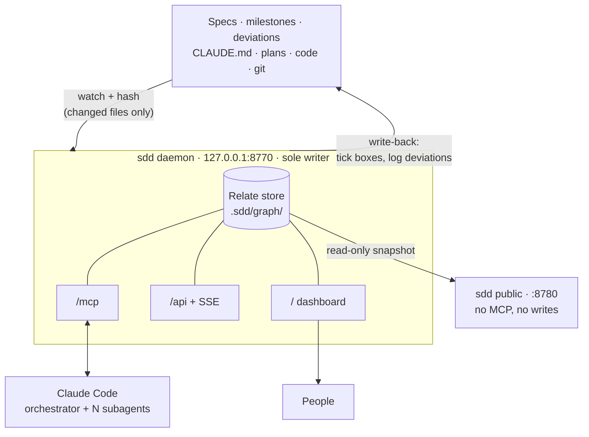
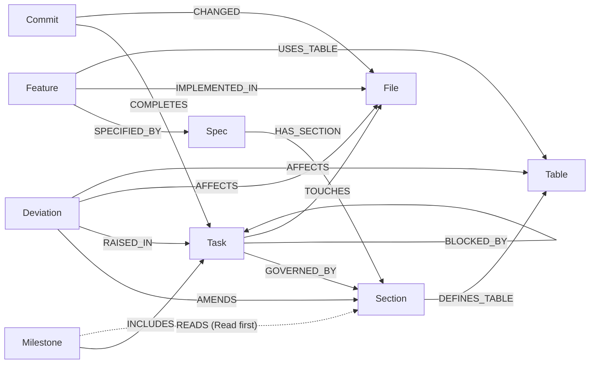

# 3. Concepts

> **For:** everyone who will use SDD Graph on a real repo. Read once; the rest of the manual assumes it. **Time:** 10 minutes.

## 3.1 Markdown is the source of truth; the graph can always be rebuilt

Your specs, milestones and deviation files stay the source of truth. People keep editing them in their editor and reviewing them in pull requests, as before. SDD Graph **reads** them into a graph and **writes back** only a few mechanical edits (ticking a box, adding a deviation, writing a DONE line).

Because of that rule:

- You can delete the graph and rebuild it from Markdown, code and git at any time (`sdd sync --reset`).
- If the graph and a file disagree, **the file wins**. The daemon re-syncs a file whenever its content hash changes.
- The graph never holds anything you'd be sad to lose, except **graph-only state**:
  - **claims** (who holds which task right now),
  - **agents** (names and when each was last seen),
  - **events** (the history: who claimed, completed or logged what, with completion notes and files touched),
  - the links tools add from that history (task `TOUCHES` file, commit `COMPLETES` task when given to `complete_task`).

  A rebuild drops these. Everything else comes back exactly.

Deviation links survive a rebuild too: when an agent logs a deviation, the task it was raised in and the files it affects are written **into the deviation file**, so a rebuild finds them again.

## 3.2 The daemon is the only writer

[Relate](https://relatedb.ai/) is an embedded graph database, closer to SQLite than to a database server. It lives in a folder (`.sdd/graph/`) inside your repo, and **only one process at a time may open it for writing**. A second writer gets "storage locked".

So SDD Graph has exactly one writer per repo: **`sdd daemon`**. It:

- watches your files (polling inside Docker, native events elsewhere) and re-parses only what changed;
- polls git for new commits every 3 seconds;
- runs every write (sync, claim, complete, deviation) through **one queue on one thread**, so writes never interleave;
- serves **MCP** at `/mcp`, the **JSON API** at `/api`, and the **dashboard** at `/`, all on `127.0.0.1:8770`.

Everything else talks to the daemon:

- **Claude Code** connects over MCP on **HTTP**, never stdio. With stdio, each Claude Code session (and each subagent) would start its own server, and they'd fight over the store. Over HTTP they all share one daemon.
- The **CLI** finds a running daemon through `.sdd/daemon.json` plus a health check, and sends its requests to the API. With no daemon running, read commands open a read-only snapshot of the store, and write commands (`sync`, `ids --write`) open the store themselves.
- The **public server** (`sdd public`) opens a read-only snapshot and never writes.

## 3.3 Nodes and links

Every document becomes nodes with human-readable IDs:

| Node | ID example | From |
|---|---|---|
| Spec | `SPEC-03` | `docs/specs/SPEC-03-booking-rules.md` |
| Section | `SPEC-03#2`, `SPEC-02#bookings` | each `##`–`####` heading, with its own text |
| AcceptanceCheck | `SPEC-03#ac2` | numbered items under an *Acceptance checks* heading |
| Milestone | `M05a` | `docs/milestones/M05a-waitlist.md` |
| Task | `M05a.3` | `- [ ] **M05a.3** …` |
| Deviation | `D006` | `docs/deviations/D006-….md` |
| Doc | `doc:CLAUDE.md` | CLAUDE.md, README, IDEA, plan files |
| File / Folder | `file:src/booking/overlap.py` | the code walker (contents are never stored) |
| Commit | `commit:<sha>` | git history |
| Table / Column | `table:bookings`, `column:bookings.ends_at` | schema tables in your schema spec |
| Feature / Domain | `feature:booking` | optional `**Feature:**` lines in spec headers |

The links between them come from what you already write: Markdown links, spec references such as `SPEC-03 §2`, `(after M05a.2)`, backticked file and table names, `[M05a.2]` in commit messages, and `> **DEVIATION:**` notes. The core shape:

That chain (spec → section → task / deviation / table / file → commit) is what makes *Impact* and *Explain* possible. "What does changing `bookings` touch?" is one graph walk instead of a dozen grep-and-read rounds. The full list is in [Graph schema](reference/graph-schema.md).

**A reference to a section includes its subsections.** `SPEC-00 §6` means §6 and §6.1 to §6.7. Every reader (context packets, `read_section`, the benchmark) expands it.

## 3.4 Claims

A **claim** is an agent's exclusive hold on a task. It exists only in the graph.

- **Claimable** means: status `todo`, no live claim, every `(after …)` task done, and every milestone this one `Depends on` done. `next_tasks` returns claimable tasks in milestone order, then task order.
- `claim_task` checks and sets in **one transaction on the single writer**, so of two simultaneous claims exactly one wins. The other gets `already_claimed`. Re-claiming your own task is fine.
- **Agents name themselves.** Every tool takes an `agent` name (`opus-orch`, `sonnet-1`), because Claude Code subagents share their parent's MCP connection. Use the **same name every session**, so your claims and your `what_changed` history follow you.
- **Liveness.** Any tool call that passes `agent` updates that agent's `last_seen`. A claim goes **stale** when its holder hasn't been seen for `SDD_CLAIM_TTL` (default **2 hours**, long enough for a long build). Anyone may then claim the task. There is no heartbeat tool.
- **Forced release.** If you know an agent has died, don't wait two hours: `release_task(task, agent=<you>, force=true)` frees it now. The event records who forced it.
- **Hand edits still count.** If a person ticks a box by hand, the task is done and any claim on it is cleared.

## 3.5 Context packets

`get_context(task)` returns the **minimum an agent needs to build one task**, so it doesn't read whole files:

| Part | Contents |
|---|---|
| `task`, `milestone` | the task line; the milestone's goal, acceptance criteria and model |
| `sections` | **full text** of the sections the task line links to (and their subsections), the *Acceptance checks* of any spec whose checks it verifies, and every section in `always_include` (default `SPEC-00 §6`, your global conventions) |
| `outline` | the milestone's other *Read first* sections, as ID + title + size only. The agent fetches what it needs with `read_section` |
| `deviations` | every deviation amending an included section. Open ones carry *what the implementation does* |
| `upstream` | the tasks it waits on and the finished tasks of the same milestone, with their completion notes and files touched |
| `code` | features of the governing specs, their files (up to 50), tables mentioned, the 5 latest commits touching those files |
| `size`, `synced_at` | characters, estimated tokens, anything dropped to fit `max_chars`; when the graph last synced |

**The packet is only as small as your task lines are precise.** A task line that links `SPEC-03 §3` gets §3 in full and the rest as an outline. A task line that links nothing falls back to the whole *Read first* list, which is no smaller than reading the files. See [Write task lines that get small packets](how-to/link-tasks-to-sections.md).

## 3.6 Write-back

The daemon edits Markdown **for** the agent, inside the same transaction that changes the graph:

| Tool | Edit in your files |
|---|---|
| `complete_task` | `- [ ] **M05a.3**` becomes `- [x] **M05a.3**`. Nothing else on the line changes |
| `log_deviation` | (1) a new `docs/deviations/D<next>-<title>.md` from your template; (2) a row at the top of the index in `docs/DEVIATIONS.md`; (3) a `> **DEVIATION:** see [D<n>](…) — summary` line at the end of each amended section |
| `complete_milestone` | the `**Status:**` paragraph becomes `**Status:** DONE (<date>). <verification> Deviations: <list or none>.`, the file (and its plan file) moves to `done/` if that folder exists, and every relative link to it is rewritten |
| `sdd export --claude-status` | only the text between `<!-- sdd:status -->` and `<!-- /sdd:status -->` in CLAUDE.md |

Rules that keep this safe:
- Writes are atomic (temp file + rename) and keep your line endings (LF or CRLF), final newline and encoding.
- The target is found again by ID just before editing, never by a remembered line number. If a person deleted it, the tool fails with `source_changed` and the graph is not changed.
- The daemon re-hashes the file it wrote, so the watcher doesn't sync it a second time.
- **The daemon never commits to git.** People and agents commit.
- `writeback = false` in `.sdd/config.toml` turns it off. `complete_task` then records completion in the graph only, and `log_deviation` and `complete_milestone` refuse with `writeback_disabled`.

## 3.7 Deviations, decisions and spec changes

Three different things change what the code should do. Keep them apart:

| | What it is | Who writes it | Where | When |
|---|---|---|---|---|
| **Spec change** | The rule itself changes ("cancelled bookings are now kept") | A person (you, a PM, a client) | Edit the spec section | Before or between milestones. The daemon notices, marks the section changed, and agents see it in `what_changed` |
| **Deviation** | The code **knowingly** differs from the spec as written, for a reason found while building | The agent or developer, with `log_deviation` | `docs/deviations/D<nnn>-….md` + index row + note in the spec | In the same change as the code that departs. **An unlogged deviation is a bug** |
| **Decision** | A choice the specs don't settle, recorded with its reasons | A person | Your own decision records (this repo uses `docs/decisions/DEC-nnn-….md`) | When a design question comes up. SDD Graph doesn't parse decisions specially; they're Docs if listed in `docs` |

A deviation has a life cycle: it starts **Open**. When everyone agrees it should become the rule, someone updates the spec, sets the deviation's status to **Resolved → spec updated**, and removes the note from the spec. Open deviations show up in every context packet that includes the amended section, so the next agent doesn't "fix" the code back to the old spec.

See [Log a deviation](how-to/log-a-deviation.md) and [Handle a spec change](how-to/handle-a-spec-change.md).

## 3.8 `what_changed` and sessions

Instead of re-reading files at the start of a session, an agent calls `what_changed(since="last_session", agent=<its name>)`. That returns everything since **that agent's previous `what_changed` call**: sections changed, specs added or removed, deviations, tasks claimed and completed, milestones done, each with who did it and when. The first call ever returns the last 24 hours. No session boundaries are guessed.

## 3.9 The parts, in one place

| Part | Command | Writes? | Port |
|---|---|---|---|
| Daemon | `sdd daemon` | the only writer | `127.0.0.1:8770` |
| CLI | `sdd …` | through the daemon, or directly when none runs | none |
| Public server | `sdd public --store …` | never | `127.0.0.1:8780` |
| Dashboard | served by both servers | through the daemon only | same as server |
| Static demo | `sdd site` | none (static files) | GitHub Pages |
