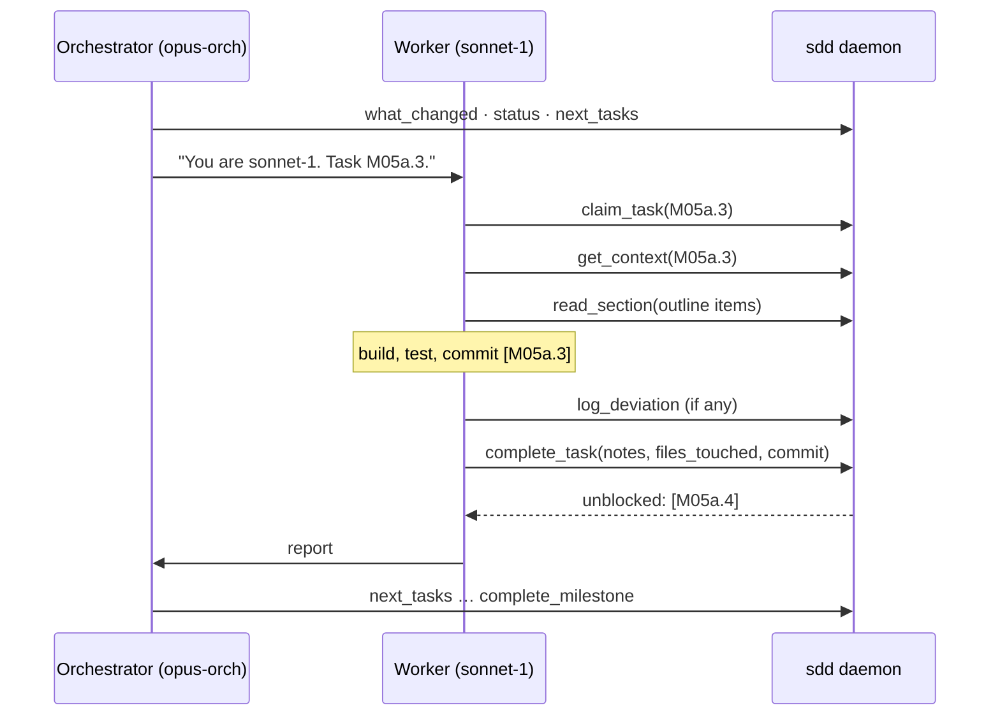

# Guide for agents

> **For:** AI coding agents (Claude Code and any MCP client) working a repo served by SDD Graph, and the people who write their instructions. Tool details: [MCP tools reference](reference/mcp-tools.md).

## What you're connected to

The `sdd` MCP server holds the repo's specs, milestones, tasks, deviations, code and git history as one graph. **Markdown stays the source of truth**: the tools read it for you and write it back safely. Use the tools instead of reading spec and milestone files. They give you exactly the sections your task needs, and they can't collide with other agents working in parallel.

## Your name

Pass **`agent`** on every call: your own name, **the same one every session**. The main session is `opus-orch`; subagents get theirs from the orchestrator (`sonnet-1`, `sonnet-2`, …). The name is your identity. Subagents share their parent's MCP connection, so the connection can't tell you apart. The name also keeps your claims alive and anchors `what_changed(since="last_session")`.

## The protocol

### Every session start

```
what_changed(since="last_session", agent="<your name>")
```

It returns sections changed, specs added or removed, deviations logged, tasks claimed and completed, and milestones done since **your** previous call. Do this instead of re-reading docs. Your first call ever returns the last 24 hours.

### Orchestrator

1. `status` for the milestones and live claims, then `next_tasks(milestone=…)` for the claimable tasks.
2. Launch **one subagent per task that has an empty `overlaps`**. Tell each its agent name and its task ID, and to follow the worker protocol.
3. Review the work each one returns (diff, tests). `complete_task` results list newly `unblocked` tasks: call `next_tasks` again for the next wave.
4. If a subagent failed or died, free its task with `release_task(task_id, agent=<your name>, force=true)` and relaunch.
5. When every task is done and the milestone's acceptance criteria are verified: `complete_milestone(milestone_id, agent, verification="<how it was verified>")`.

### Worker

1. `claim_task(task_id, agent)`. **`already_claimed` means someone else has it: stop and report back.** `task_blocked` means it's waiting on other tasks.
2. `get_context(task_id, agent)`. You get the governing sections in full, the deviations that amend them, acceptance checks, notes from upstream tasks, and related code. `read_section` anything in `outline` you need. **Do not read spec files.**
3. Build and test.
4. `log_deviation` for **every** intentional departure from a spec. One call writes the deviation file, the index row and the spec note.
5. Commit, naming the task: `feat: promote the oldest entry [M05a.2]`.
6. `complete_task(task_id, agent, notes, files_touched, commit)`, then report to the orchestrator.



## The rules

1. **Never edit task checkboxes by hand.** `complete_task` ticks the box, records your notes and files, links the commit and unblocks the next tasks. A hand tick loses all of that (and clears any claim).
2. **Always `claim_task` before you start.** A claim is the only thing that stops two agents doing the same work.
3. **Log every departure with `log_deviation`**, in the same change as the code. Don't write deviation files, index rows or spec notes yourself. The tool picks the next free number inside one transaction, so parallel agents never collide. An unlogged deviation is a bug.
4. **Never edit spec text** to match your code. If the spec is wrong, log a deviation; a person decides whether the spec changes.
5. **Pass `agent` on every call, including reads.** It keeps your claim alive. A claim goes stale after 2 hours without any call carrying your name.
6. **Respect `overlaps`.** Don't launch parallel work on tasks that share a governing section or a mentioned file.
7. **Don't run `sdd sync`, `sdd ids --write`, or anything that opens the store.** The daemon owns it.
8. **Check `synced_at`** if something looks stale. If the daemon is down (tools fail to connect), fall back to reading the Markdown with `grep -n '^## '` and targeted reads, and say so.

## Useful extras

| Need | Tool |
|---|---|
| A section by reference, with subsections | `read_section(["SPEC-03 §4.2", "SPEC-02 \`bookings\`"])` |
| What a change will touch | `impact("bookings")`, `impact("SPEC-03 §4")` |
| Why a file exists | `explain("src/booking/overlap.py")` |
| Files for a feature or table | `find_code(table="bookings")` |
| Anything else, read-only | `query("MATCH … RETURN …")` (no writes or `CALL`, `*..4` at most, 100 rows, 5 s) |

## Handling errors

| Code | Do |
|---|---|
| `already_claimed` | pick another task from `next_tasks`, or report back |
| `task_blocked` | the `details` list what it waits on; pick another |
| `not_claimed_by_you` | you don't hold it: claim it first (workers), or `force` (orchestrator, holder dead) |
| `source_changed` | a person edited the target line or section; re-read and retry |
| `unknown_section` | a reference in `amends` or `read_section` doesn't resolve; fix it |
| `write_conflict` | retryable; call again |
| `milestone_incomplete` | the message lists the open tasks |

Full list: [Error codes](reference/error-codes.md).

## Copy-paste CLAUDE.md block

Put this in your repo's CLAUDE.md (`sdd init` prints a shorter version):

```markdown
## Agents (SDD Graph)

This repo is served by the SDD Graph daemon (`sdd daemon`, MCP server `sdd` in `.mcp.json`).
Follow `.claude/skills/sdd/SKILL.md`. Markdown stays the source of truth; the tools read and
write it for you.

- **Names.** Pass `agent` on every call, the same name every session: `opus-orch` for the main
  session; subagents get `sonnet-1`, `sonnet-2`, … from the orchestrator.
- **Session start:** `what_changed(since="last_session", agent="<your name>")` instead of
  re-reading docs.
- **Orchestrator:** `status` → `next_tasks` → one subagent per task with empty `overlaps`
  (tell it its name and task ID) → review → `release_task(…, force=true)` for a failed one →
  `complete_milestone` when acceptance is verified.
- **Worker:** `claim_task` → `get_context` → `read_section` for what `outline` lists →
  build and test → `log_deviation` for every departure from a spec → commit as
  `feat: … [M02.3]` → `complete_task` with notes, files_touched and commit → report.
- **Never** tick checkboxes, write deviation files or edit spec text by hand. Never run
  `sdd sync` while the daemon runs.
- **Task lines** link the spec sections they implement (`[SPEC-04 §2](…)`) and state order
  with `(after M02.1)`. New tasks take the next free number; numbers are never reused.
- Fall back to reading the Markdown (`grep -n '^## '` + targeted reads) only if the daemon
  is down.
```

## Starting the daemon for a session

If your harness lets you, check the daemon is up before working: `curl -s http://127.0.0.1:8770/api/health` should return `{"ok": true, …}`. If it isn't, ask the user to run `sdd daemon` (or the Docker equivalent) rather than starting a second writer yourself.
