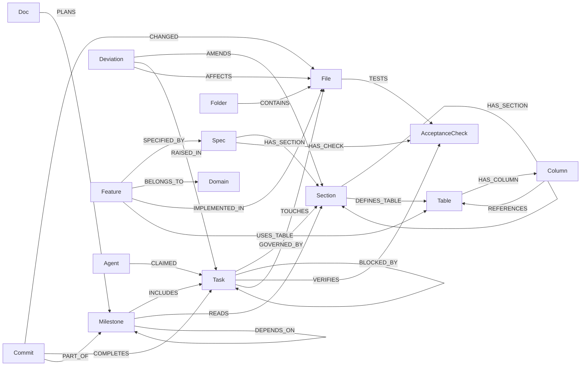

# Graph schema

> Every node label and relationship type, with the properties that matter for queries. The source of truth is [SPEC-02](../../specs/SPEC-02-graph-schema.md). Live counts: `sdd info`, or the `schema` preset in the dashboard.

## IDs

| Label | `id` | Example |
|---|---|---|
| Spec | `SPEC-NN` | `SPEC-03` |
| Section | `<spec>#<number>`, or `<spec>#<slug>` if unnumbered | `SPEC-03#5.2`, `SPEC-02#bookings` |
| AcceptanceCheck | `<spec>#ac<n>` | `SPEC-03#ac6` |
| Milestone | `M<digits>[a-z]` | `M05a` |
| Task | `<milestone>.<n>` | `M05a.3` |
| Deviation | `D<nnn>` | `D006` |
| Doc | `doc:<path>` | `doc:CLAUDE.md` |
| Folder / File | `dir:<path>` / `file:<path>` | `file:src/booking/overlap.py` |
| Commit | `commit:<full sha>` | |
| Table / Column | `table:<name>` / `column:<table>.<name>` | `column:bookings.ends_at` |
| Feature / Domain | `feature:<slug>` / `domain:<slug>` | `feature:booking` |
| Agent | `agent:<name>` | `agent:sonnet-2` |
| Event | `event:<ulid>` | |
| Meta | `meta` (one node) | |

Every parsed node also has `source_path`, `source_line` (where it applies), `content_hash` and `last_synced`. Paths are POSIX and project-relative; timestamps are UTC ISO strings ending in `Z`.

## Node properties

### Planning

| Label | Properties |
|---|---|
| **Spec** | `title`, `status`, `owner_of`, `header` (map, stored as `header_json`) |
| **Section** | `spec_id`, `number` (null if unnumbered), `title`, `anchor` (GitHub anchor), `level` (2–4), `line_start`, `line_end`, `text` (own body, without children), `changed_at` (set when its text changes after the first sync) |
| **AcceptanceCheck** | `spec_id`, `number` (int), `text` |
| **Milestone** | `title`, `order` (sort key: `0005a`), `status` (`todo`/`in_progress`/`done`), `status_text`, `done_date`, `model`, `goal`, `acceptance` (list), `path` |
| **Task** | `milestone_id`, `title`, `group`, `order` (int), `checked` (bool), `status` (`todo`/`claimed`/`done`, derived), `stable_id` (bool), `claimed_by`, `claimed_at`, `completed_by`, `done_at`, `notes` |
| **Deviation** | `title`, `date`, `status` (`open`/`resolved`), `status_text`, `spec_says`, `implementation_does`, `why`, `consequences` |
| **Doc** | `kind` (`idea`, `claude_md`, `plan`, `design_system`, `handoff`, `readme`, `other`), `title`, `path` |
| **Meta** | `schema_version`, `last_git_sha`, `last_full_sync`, `project_name` |

A node with links that don't resolve yet carries `unresolved` (list of strings).

### Code

| Label | Properties |
|---|---|
| **Folder** | `path`, `name` (there is no root folder) |
| **File** | `path`, `name`, `language`, `size`, `lines`, `content_hash`, `is_test`. **Contents are never stored** |
| **Commit** | `sha`, `short`, `message` (subject), `author` (name only), `at`, `paths` (every path in the diff) |
| **Table** | `name`, `defined_in` (section ID) |
| **Column** | `table`, `name`, `type`, `nullable`, `pk`, `notes` |
| **Feature** | `name`, `slug`, `globs` |
| **Domain** | `name`, `slug` |

### Graph-only

| Label | Properties |
|---|---|
| **Agent** | `name`, `first_seen`, `last_seen` (decides stale claims), `last_changes_at` (defines `since="last_session"`) |
| **Event** | `at`, `kind` (`task_claimed`, `task_released`, `task_completed`, `deviation_logged`, `section_changed`, `spec_added`, `spec_removed`, `milestone_done`, `sync`), `actor`, `target_id`, `summary`, `data` (map, stored as `data_json`: notes, files touched, commit, `forced_by`). Append-only |

## Relationships

| Type | From → To | Comes from |
|---|---|---|
| `HAS_SECTION` | Spec → Section, Section → Section | headings |
| `HAS_CHECK` | Spec → AcceptanceCheck | *Acceptance checks* |
| `LINKS_TO` | Section \| Doc → Section \| Spec \| Milestone \| Deviation \| Doc \| File | links and spec references in text |
| `DEPENDS_ON` | Milestone → Milestone | **Depends on:** (and reversed **Blocks:**) |
| `READS` | Milestone → Section \| Spec | **Read first:**; `{whole: true}` for "(whole file)" |
| `INCLUDES` | Milestone → Task | checkboxes |
| `BLOCKED_BY` | Task → Task | `(after …)` |
| `GOVERNED_BY` | Task → Section \| Spec | references in the task line |
| `VERIFIES` | Task → AcceptanceCheck | `checks 3–9` in the task line |
| `PLANS` | Doc → Milestone | plan files |
| `AMENDS` | Deviation → Section \| Spec | **Spec:** field and `**DEVIATION:**` notes |
| `RAISED_IN` | Deviation → Milestone \| Task | **Date / milestone:** field, milestone status text |
| `AFFECTS` | Deviation → File \| Table | **Affects:** field |
| `MENTIONS` | Section \| Task \| Deviation → Table \| File | backticked names that match |
| `CLAIMED` | Agent → Task | graph-only, `{at}` |
| `ABOUT` | Event → any | graph-only |
| `CONTAINS` | Folder → Folder \| File | walker |
| `PARENT` | Commit → Commit | git |
| `CHANGED` | Commit → File | git, `{change: A\|M\|D\|R}` |
| `COMPLETES` | Commit → Task | `[M05a.2]` in the message, or `complete_task(commit=…)` |
| `PART_OF` | Commit → Milestone | `(M05a)` in the message when no task ID |
| `TOUCHES` | Task → File | `complete_task(files_touched)`, and files changed by commits completing the task |
| `TESTS` | File → AcceptanceCheck | test names matching `spec(\d+)_ac(\d+)` |
| `DEFINES_TABLE` | Section → Table | schema tables |
| `HAS_COLUMN` | Table → Column | schema tables |
| `REFERENCES` | Column → Table | `→ users`, `FK → users` |
| `SPECIFIED_BY` | Feature → Spec | Feature line |
| `BELONGS_TO` | Feature → Domain | Feature line |
| `IMPLEMENTED_IN` | Feature → File | Feature line globs |
| `USES_TABLE` | Feature → Table | Feature line |

### Who owns a relationship: `src`

Every relationship has a `src` property that says who created it and who may delete it:

| `src` | Owner | Deleted when |
|---|---|---|
| a file path | the parser of that file | that file is re-synced or removed |
| `walker` | the code walker (`CONTAINS`, `IMPLEMENTED_IN`, `TESTS`) | the walker rebuilds them |
| `git:<sha>` | git sync | that commit becomes unreachable (rebase, reset) |
| `tool` | a write tool (graph-only) | never by sync; only by `sdd sync --reset` |

The same pair of nodes can have two relationships of one type with different `src`. For example, a deviation's file and a spec note both create `AMENDS` to the same section. Use `DISTINCT` in queries when that matters.

## Graph-only state

Lost by `sdd sync --reset`, kept by a normal sync:

- Nodes: Agent, Event.
- Task properties: `claimed_by`, `claimed_at`, `completed_by`, `done_at`, `notes`.
- Relationships: `CLAIMED`, `ABOUT`, and every relationship with `src = "tool"`.

`RAISED_IN` and `AFFECTS` are **not** graph-only: `log_deviation` writes them into the deviation file.

## Indexes

- A unique `id` on every label.
- Property indexes on `Task.status`, `Task.milestone_id`, `File.path`, `Section.spec_id`, `Event.at`.
- Full-text indexes `ft_section_text` (section title and text) and `ft_file_path`. They are used internally; the query guard rejects `CALL`, so you can't query them directly. Use `CONTAINS` on properties instead.
